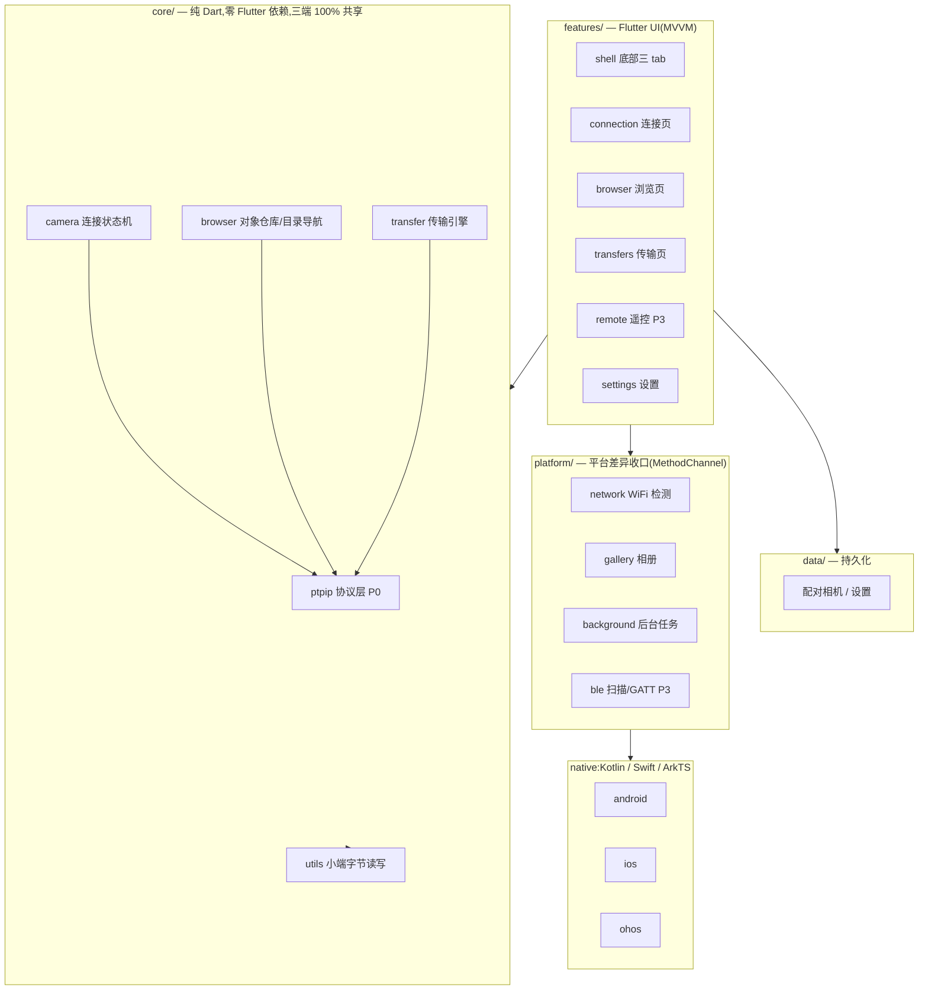

# NikonBridge 架构

> 三端(iOS / Android / HarmonyOS)尼康相机无线传输工具。
> 技术栈:Flutter(HarmonyOS 走 OpenHarmony-SIG flutter_flutter fork),
> 单一 `lib/` 代码库。功能清单与优先级见 [TODO.md](../TODO.md)。

## 1. 总体分层

**依赖铁律**(analyzer + review 双重把关):

1. `core/` 不 import 任何 `package:flutter/**`(纯 Dart,可脱离 Flutter 单测)
2. `core/` 不感知平台 —— 对 WiFi/相册/后台/BLE 的需求只依赖 `platform/` 接口
3. UI 按钮**必须**绑定 ViewModel(ChangeNotifier),禁止绕过 Controller 直连协议层
4. 依赖方向单向:`features → core / platform / data`,`platform → core(仅模型)`,无环

## 2. 模块职责

| 目录 | 职责 | 对应 TODO |
|---|---|---|
| `lib/core/ptpip` | 包模型/小端编解码/双 TCP 通道/会话事务状态机 | §一 P0 |
| `lib/core/camera` | WiFi 启发式、连接状态机(Stream 驱动 UI)、Probe 心跳 | §二 |
| `lib/core/browser` | GetObjectHandles+GetObjectInfo 组合、目录路径栈 | §三 |
| `lib/core/transfer` | 队列/去重/指数退避、流式写盘、速度估算 | §四 |
| `lib/platform` | 三端 MethodChannel 契约与 Dart 侧实现 | §四/§二 |
| `lib/data` | 配对相机、设置(现为内存桩,P2 换 drift/shared_preferences) | §五 |
| `lib/features` | 三 tab UI + ViewModel | §七 |
| `tools/ptpip_probe` | Python 真机验证 CLI(协议实现的前置关卡) | §一 P0 |

## 3. 关键数据流

**连接**:UI `connect()` → `CameraConnectionImpl` → WiFi 启发式(`platform/network`)
→ `PtpIpSession.connect()`(command + event 双 socket,均 15740)→ InitCommand/InitEvent
握手 → `openSession(0x1002)` → 启动 `ProbeKeepalive` → 状态 Stream 驱动 UI 着色。

**浏览**:`DirectoryNavigator.refresh()` → `ObjectRepositoryImpl.listFolder()` →
`PtpIpSession.getObjectHandles(parent)` + `getObjectInfo(handle)` → `ObjectEntry` 列表。
handle **只能**来自 GetObjectHandles 响应。

**传输**:浏览页勾选 → `TransferEngine.enqueue()`(按 handle 去重)→ 串行执行
`PtpIpSession.getObject(handle)` 流 → 临时文件**边收边写** → `GallerySaver.importFile()`
进系统相册 → 清理 → 进度经 `tasks` Stream 驱动 UI;失败指数退避重试(上限 3)。

## 4. 三端平台契约

channel 命名统一 `nikonbridge/<service>`,完整契约表见
[lib/platform/services.dart](../lib/platform/services.dart)。三端能力差异的降级策略:

| 能力 | Android | iOS | HarmonyOS |
|---|---|---|---|
| WiFi SSID 检测 | ConnectivityManager | **拿不到**(降级:网关直连) | wifiManager |
| 后台传输 | WorkManager+前台服务(可靠) | BGTaskScheduler(尽力,前台续传) | 后台任务+通知 |
| 相册 | MediaStore | PHPhotoLibrary | photoAccessHelper |
| BLE | TRANSPORT_LE,免配对 | CoreBluetooth | ble kit |
| 强切 WiFi | **不可能**(Android 10+,保持手动连接模式) | 同左 | 同左 |

## 5. 测试策略

- **字节级**:ptpip 编解码单测(小端、半包、u64 大文件、UTF-16LE)—— 防"静默丢弃"
- **状态机**:注入 Fake channel/repository,覆盖连接/传输/导航路径
- **真机**:tools/ptpip_probe 先行,任何协议常量以真机响应为准回填 Dart 侧
- 功能就绪标准(TODO 注意事项 8):真实数据、端到端跑通才算完成

## 6. 实现顺序(按 TODO 优先级)

1. **P0** `tools/ptpip_probe` 真机握手 → 结论回填 → `core/ptpip` 编解码 + 单测 → 会话
2. **P1** 连接状态机 → 浏览链路 → 传输入队/流式下载/相册;生成三端工程
3. **P2** 心跳保活、多选/过滤/排序、缩略图、传输列表、持久化(drift/shared_preferences)
4. **P3** BLE、遥控拍摄、传输质量等增值项
