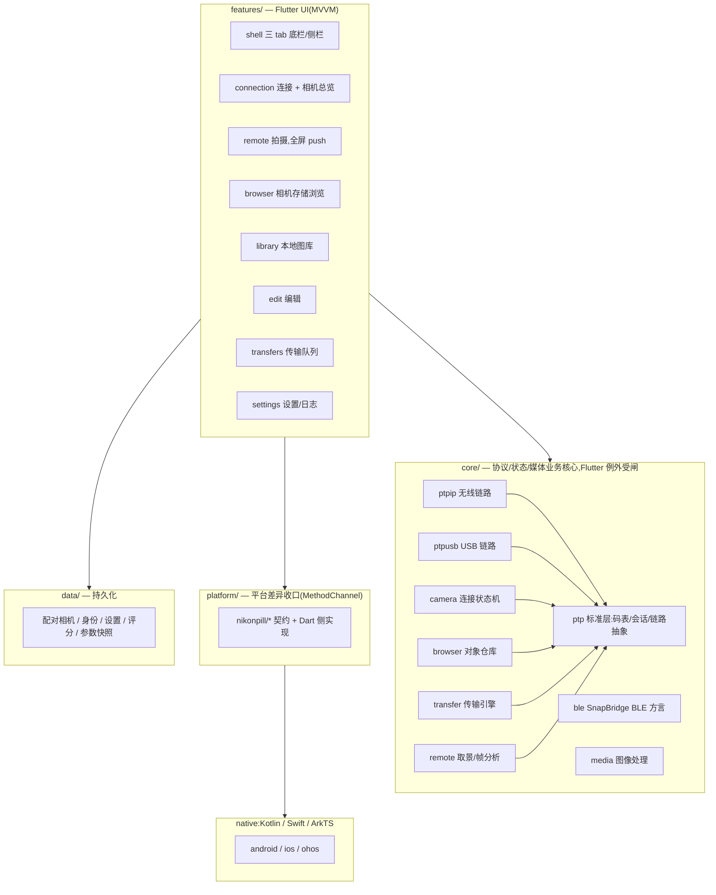

# NikonPill 架构

> 三端(iOS / Android / HarmonyOS)尼康相机无线遥控与传输工具。
> 技术栈:Flutter(HarmonyOS 走 OpenHarmony-SIG flutter_flutter fork),
> 单一 `lib/` 代码库。功能总览与环境准备见 [README.md](../README.md)。
> 无线 / USB 双链路、取景拍摄、传输、图库主线均已真机验收。

## 1. 总体分层

**依赖铁律**(`tools/check_architecture.dart` + review 双重把关):

1. `core/` 默认是纯 Dart;仅 6 个 UI 相邻文件可按精确 import 白名单使用
   `ValueNotifier` / `ChangeNotifier` 或 `dart:ui` 图像处理 API,名单只能收缩
2. `core/` 对 BLE、USB、相册、RAW 解码只依赖 4 个 `platform/` 契约入口
   (共 5 条 import),不得引用平台具体实现
3. `core/` 禁止反向 import `features/`、`data/`、`app_*`、`design/`、`debug/`
4. UI 按钮**必须**绑定 ViewModel(Controller),禁止绕过 Controller 直连协议层
5. 依赖方向单向:`features → core / platform / data`,`platform → core(仅模型)`,
   `data → core(仅模型)`,无环

## 2. 模块职责

| 目录 | 职责 |
|---|---|
| `lib/core/ptp` | PTP 标准层:操作/响应/事件码、`PtpSession` 事务状态机(全局串行锁)、链路无关 `PtpTransport` 抽象与 `PtpLinkRouter`(USB/无线切换不重建下游对象图) |
| `lib/core/ptpip` | 尼康 Wi-Fi 方言:包模型/小端编解码/command+event 双 TCP 通道/事务路由与取消 |
| `lib/core/ptpusb` | PTP/USB:bulk/中断容器编解码、USB 传输 |
| `lib/core/ble` | SnapBridge BLE 方言:四步配对握手与身份复用重连、WiFi 凭据读取、TIME 保活、GEO 注入 |
| `lib/core/camera` | WiFi 启发式与发现、连接状态机(Stream 驱动 UI)、保活、重连策略 |
| `lib/core/browser` | GetObjectHandles+GetObjectInfo 组合、相册分组、存储信息、缩略图缓存、文件操作 |
| `lib/core/transfer` | 队列去重/串行下载/指数退避、AIMD 分块、相册导入编排、ObjectAdded 速传 |
| `lib/core/remote` | 取景轮询引擎与 watchdog、帧分析(直方图/斑马纹/伪色/峰值)、示波器、间隔拍摄、参数快照 |
| `lib/core/media` | .cube LUT、胶片预设、水印、XMP、Motion Photo、JPEG 方向 |
| `lib/core/log` | 统一日志门面 AppLog:分级分域 + 环形缓冲 + 脱敏,原生日志合流 |
| `lib/core/utils` | 小端字节读写器(全协议读写的唯一通道) |
| `lib/features` | UI(MVVM):shell / connection / remote / browser / library / edit / transfers / settings |
| `lib/platform` | 三端 MethodChannel 契约与 Dart 侧实现(`nikonpill/<service>`) |
| `lib/data` | 持久化:配对相机、BLE/客户端身份、设置、评分、拍摄参数快照 |
| `lib/design` / `lib/l10n` / `lib/debug` | 设计 token、键化文案(zh/en + 完整性闸)、PTP 诊断 |
| `tools/` | mock_camera(假相机)/ ptpip_probe / usb_probe / ble_pair 探针 |

## 3. 关键数据流

**装配**([lib/app_services.dart](../lib/app_services.dart)):USB
(`WatchdogUsbHostChannel → UsbPtpTransport`)与无线(`PtpIpTransport`,
每连接新建)两条链路在 `PtpLinkRouter` 汇合喂单例 `PtpSession`,下游
`ObjectRepository / ThumbnailCache / ObjectDownloader → TransferEngine`
及各 Controller 全部绑在 session 上,不感知链路切换。

**连接(无线)**:连接页选方式 ——
AP:热点启发式检测(SSID 片段/网段)→ 默认网关直连 `192.168.1.1:15740`;
STA:相机入同一局域网,mDNS `_ptp._tcp` 自动发现后直连;
BLE 配对:四步握手(身份持久化,重连免重配)→ GATT 读出 WiFi 凭据、
写开关唤醒相机 WiFi → join AP(Android / HarmonyOS 程序化加入,iOS 按
手动指引降级)→
转 AP 流程。殊途汇入同一 `CameraConnection` 状态机:
`detecting → connecting → pairing`(首连配对码确认)→ `connected`;
断链转 `reconnecting` 按退避重拨(取景页保留冻结帧不弹回),预算耗尽转
`failed`;状态 Stream 驱动 UI 着色。

**连接(USB)**:插线 → `nikonpill/usb` claim 接口 → `UsbPtpTransport`
attach 进路由器,同一状态机同一下游。

**取景**:连接即取景(RemoteController 于 connected 沿串链自驱)→
`LiveViewEngine`:0x9201 起景 → 帧间 50ms 步进轮询 0x9203 → 0x9202
收景,失败指数退避、连续 5 帧转 failed;watchdog 专管「事务成功但内容
冻结」的同帧楔死(探测命令通道,忙则保持、不忙重启取景,预算耗尽升级
整链重连);帧头解析后一份帧分析同时喂直方图/斑马纹/伪色/峰值/示波器;
高质量档经 Catmull-Rom fragment shader 上采样。拍摄页不可见只挂轮询,
取景生命周期跟连接走。

**浏览/传输**:浏览页 → `ObjectRepository`(handle 只来自
GetObjectHandles 响应)→ 相册分组 + 缩略图缓存(GetThumb/大缩略,RAW 走
iOS 原生解码、其余端回落内嵌缩略图);下载 → `TransferEngine.enqueue`
(进行中按 handle+目的地去重,FIFO 串行)→ `ObjectDownloader` 分块流式
写盘 → gallery 目的地两段式(整批落定后一次 `importFiles` 入系统相册,
对话框期间泵暂停),app 目的地直写下载目录;`AutoTransferService` 沿
ObjectAdded(0x4002,SDRAM 拍摄走尼康 0xC101)按设置开关与格式自动入队;
Android 后台下载走前台服务。

**BLE 伴生通道**:连接期间 `BleCameraSession` 维持 TIME 保活(前台 45s /
后台 90s 档,内容即当前时刻、顺带持续校时)与 GEO 注入(定位流事件驱动,
3s/1.1m 去重门,30s 无成功注入重发最后定位)—— 相机照片 EXIF 原生带坐标。

## 4. 三端平台契约

channel 命名统一 `nikonpill/<service>`,完整契约表与三端落地进度见
[lib/platform/services.dart](../lib/platform/services.dart)。
技术选型与能力差异:

| channel | Android | iOS | HarmonyOS |
|---|---|---|---|
| `network` | ConnectivityManager;**join / release / scanAps**(WifiNetworkSpecifier + bindProcessToNetwork) | 拿不到 SSID(降级:网关直连);join 受 Network Extension entitlement 限制 | wifiManager;**join / release / scanAps**(候选配置族) |
| `gallery` | MediaStore | PHPhotoLibrary | photoAccessHelper |
| `bg` | dataSync 前台服务 | BGTaskScheduler(尽力,前台续传) | backgroundTaskManager 长时任务 |
| `ble` | BluetoothLeScanner + GATT | CoreBluetooth | @ohos.bluetooth.ble |
| `usb` | UsbManager bulk | ImageCaptureCore(公开 API;dext 路线已弃) | @ohos.usb |
| `nsd` | NsdManager | NetServiceBrowser | @ohos.net.mdns |
| `motion` | SensorManager | CoreMotion | @ohos.sensor |
| `location` | LocationManager | CoreLocation(含常驻定位流) | geoLocationManager |
| `raw` | HEIF/ImageDecoder;真 RAW 回落内嵌缩略图 | ImageIO RAW 解码 | image + LibRaw(NEF/HIF/JPG) |
| `video` | MediaPlayer 全屏 + 抽帧/帧率;内嵌视图未落地 | AVKit(全屏 + 内嵌平台视图) | AVPlayer(全屏 + 内嵌平台视图) |
| `video_lut` | Media3 Transformer | AVAssetExportSession + CIColorCube | LibRaw C++ LUT 管线 |
| `log` | 原生日志合流 AppLog | 同左 | 同左 |

能力缺失时**降级而不是崩溃**是本层总原则(iOS 无 SSID → 网关直连;
后台受限 → 前台传输提示;native 缺失 → MissingPluginException 按
不可用降级,`PlatformServices.bootstrap()` 注入、测试可覆盖为 Fake)。
表中记录实现面,真机验证进度以项目本地待办账本的平台分项为准。

## 5. 测试策略

- **字节级**:ptpip / ptpusb 编解码单测(小端、半包粘包、u64 大文件、
  UTF-16LE)—— 防「静默丢弃」
- **状态机**:注入 Fake(channel/repository/transport),覆盖连接/传输/
  取景/导航路径
- **widget + golden**:页面交互用例与 golden 闸(如 STA 天线图标构图)
- **e2e 回环**:`test/e2e` 用例内起 `tools/mock_camera`(同一实现),
  我方真 transport/session 走真 TCP 全链路断言,无相机可回归
- **i18n 闸**:catalog 完整性测试(zh/en 键集与占位符一致)
- **架构/规模闸**:`dart run tools/check_architecture.dart` 检查 core 框架与
  平台契约白名单、禁止反向依赖;Dart 文件达到 2000 行必须进入
  [file_size_budget.txt](../tools/file_size_budget.txt),既有预算只能下降
- **真机**:协议常量一律探针先行、以真机响应为准回填 Dart 侧;功能就绪
  以「真实数据、端到端跑通」为准
- 规模:截至 2026-10-27 为 112 个测试文件、1634 passed / 0 skipped
  (`flutter test`)

## 6. 文档索引

- [README.md](../README.md) — 功能总览与环境/命令
- [lib/core/README.md](../lib/core/README.md) — core 分层细则
- [tools/check_architecture.dart](../tools/check_architecture.dart) — 可执行架构与文件规模闸
- [lib/core/ptpip/README.md](../lib/core/ptpip/README.md) — 尼康 Wi-Fi 方言定案
- [lib/core/ptpusb/README.md](../lib/core/ptpusb/README.md) — PTP/USB 容器差异备忘
- [lib/platform/README.md](../lib/platform/README.md) — 平台适配层现状
